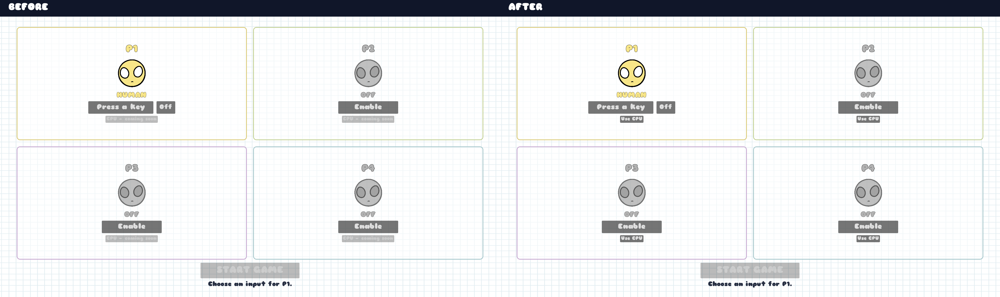
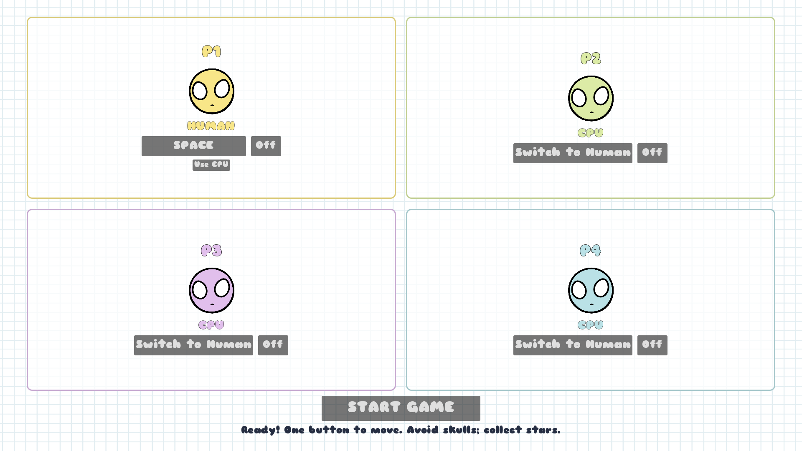
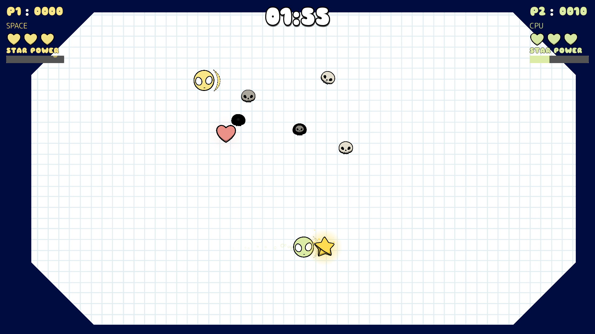
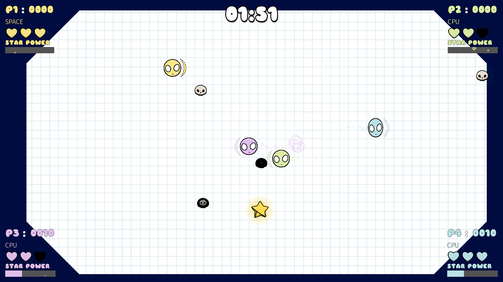
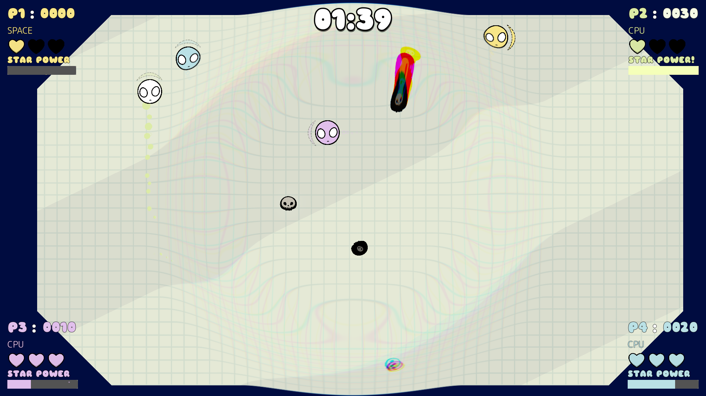
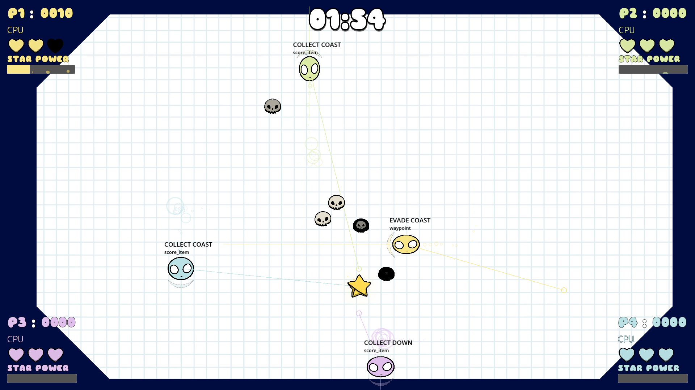
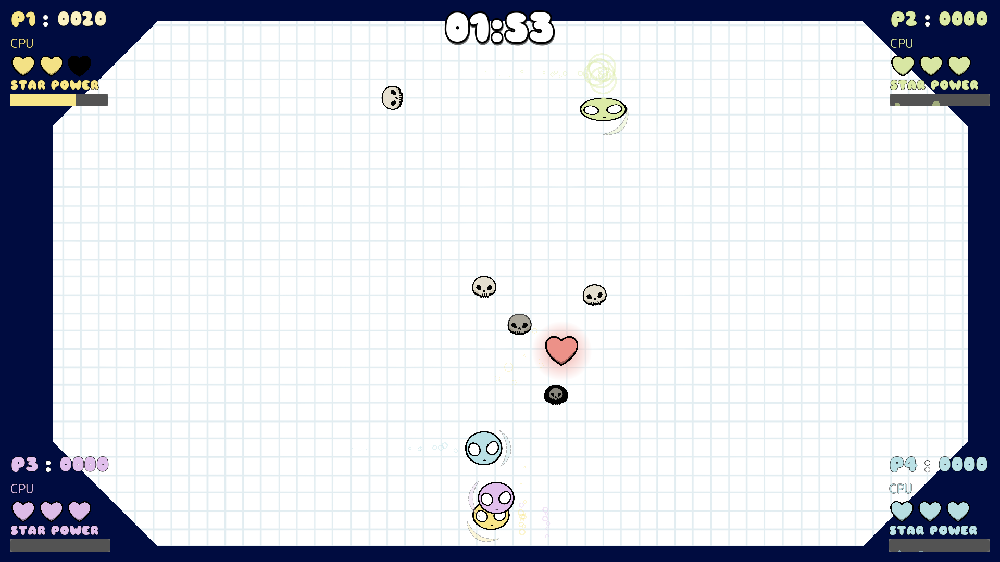

# Wishbones CPU players

Implemented 10 October 2026. Changes are uncommitted. The title → Play → four-quadrant lobby flow is retained. Choose **Use CPU** on any slot; CPU slots need no input. **Switch to Human** opens that slot's existing input capture. OFF, HUMAN and CPU can be mixed in any original slot, including CPU-only matches.

## Implementation

`Entities/Player/cpu_controller.gd` is the only additional production script. It attaches only to CPU instances of the existing Player scene. Humans retain their one-button direction cycle. CPUs choose a cardinal direction directly or coast, using the same kick impulse, mass, speed cap, collisions, health, scoring, power-up and respawn code. Direct kicks keep the stored direction and character indicator coherent. CPU input processing remains disabled after respawning.

Each decision considers at most 12 nearby observations from the spawner's existing lists and the active player list. Collected/fading pickups, spawning or dead enemies, and dead players are excluded. Decisions use an independent random stream and run about four times per second, with slight timing variation.

Goals:

- **COLLECT:** stars, with additional value near the existing three-star power threshold.
- **HEAL:** hearts only when injured; much greater value at one HP, without always abandoning nearby stars at two HP.
- **EVADE:** a close skull or powered opponent can override commitment; candidate paths are penalized for predicted damage risk.
- **HUNT:** during Star Power, seek eligible skulls and vulnerable opponents within plausible reach before expiry. Moving targets receive bounded velocity prediction, capped at 0.6 seconds.
- **ROAM:** temporary waypoints inside the existing pickup spawn region. Low displacement or prolonged lack of goal progress triggers a fresh waypoint and a brief recovery period.

Five candidates—coast and four kicks—receive eight trajectory samples over approximately one second. Kick prediction uses `min(kick_force / mass, effective_speed_cap)`; coast begins with current capped velocity. The controller reads the arena's existing WorldBoundaryShape2D and octagon polygon geometry once at setup and estimates reflections. It evaluates minimum relative distance along each path segment, including passes through targets between samples, then combines goal progress, contact value, danger, unproductive wall contact and an unnecessary-kick cost. All actual movement is performed by Godot and the original Player; the prediction never writes positions or velocities.

Goal commitment, mild aiming error, occasional hesitation and a kick cooldown limit precision. There is no simulated input, navigation mesh, behavior tree, additional character class or dependency.

The shared overlapping-Star-Power fix was already present. It remains intact: the first expiry does not reset music, background or enemy freeze while another player remains powered. CPU slots retain original IDs, colors, spawn positions and HUD corners. The existing input label shows CPU; final scores have a small CPU label in the player color with a thin outline beneath the original player name.

## Actual screenshots and recording

All PNGs are real 1920×1080 Godot viewport captures. The baseline was captured before CPU production edits and is untouched. The comparison copies both native images pixel-for-pixel and adds labels outside the rendered pixels. `screenshots.json` records dimensions and SHA-256 hashes; `captures.json` describes capture conditions.

The default lobby changes only the CPU option's availability/caption:



P1 HUMAN with SPACE and P2–P4 CPU, ready to start:



One human and one CPU:



One human and three CPUs:



Naturally earned CPU Star Power, captured after activation; not manually triggered:



Developer visualization: goal, target, chosen action, target line and faint predicted trajectory:



Four CPUs, with debug disabled:



[25-second gameplay recording](cpu_gameplay.mp4): four CPUs, original spawning and physics, no staged objects or scores. Encoded from 500 actual native viewport frames at 20 fps, with no audio. The recording starts about 11 seconds into the round. Screenshots and video use seed 250125. Humans in mixed evidence receive no input; their ordinary collisions and damage still operate.

The optional `match_frames/` directory contains 30/60/90-second checkpoints and actual final scoreboards from complete graphical matches started through the normal lobby flow.

## Validation

**205 runtime checks passed, zero failures:**

| Suite | Checks | Evidence |
|---|---:|---|
| CPU behavior, lobby and mixed-player integration | 71 | `validation.log` |
| Existing lobby interaction, updated CPU availability expectations | 56 | `lobby_regression.log` |
| Existing gameplay and overlapping power-up regression | 58 | `gameplay_regression.log` |
| Existing Escape pause regression | 20 | `pause_regression.log` |

The CPU suite tests actual GUI selection, CPU → human capture, clearing bindings, CPU-only and mixed starts, non-contiguous IDs, HUDs/results, real human key input in a mixed match, all four direct kicks and caps, useful coasting, cooldown, segment contact detection, predicted and actual wall bouncing, star/heart values, target commitment/invalidation, skull/opponent evasion, power hunting, CPU/human overlapping expiry, roaming, anti-stuck recovery, death/respawn and restarting all requested configurations. Planning fixtures disable pickup monitoring so moving test bodies cannot accidentally collect them; full matches exercise ordinary collection.

Three complete 120-second physics matches ran headlessly, then the same three configurations ran graphically with checkpoint captures. Each uses 60 physics frames per simulated second and fixed seeds; headless runs can complete faster than wall-clock time. No configuration, spawn rate, score rule or difficulty value is changed by the match harness. JSON metrics and complete logs are in `matches.json`, `matches.log` and `graphical_matches.log`.

Headless results, reproduced by the rendered runs:

| Seed / configuration | CPU | Score | Stars | Hearts | Deaths | Power activations | Attack score events | Kicks | Recovery events |
|---|---|---:|---:|---:|---:|---:|---:|---:|---:|
| 250125: H + CPU | P2 | 750 | 9 | 5 | 2 | 3 | 12 | 179 | 7 |
| 250126: H + 3 CPUs | P2 | 3890 | 7 | 7 | 1 | 2 | 23 | 177 | 2 |
| | P3 | 490 | 5 | 2 | 3 | 1 | 7 | 174 | 0 |
| | P4 | 5610 | 7 | 5 | 2 | 2 | 28 | 171 | 4 |
| 250127: 4 CPUs | P1 | 20 | 2 | 0 | 3 | 0 | 0 | 174 | 3 |
| | P2 | 13780 | 10 | 4 | 2 | 3 | 55 | 172 | 8 |
| | P3 | 2390 | 5 | 5 | 3 | 1 | 13 | 165 | 5 |
| | P4 | 1240 | 4 | 5 | 3 | 1 | 10 | 167 | 1 |

Each CPU used all four directions. Peak speeds were the existing 500 and 1000 caps, within floating-point tolerance. CPUs pursued pickups, gathered hearts when injured, entered hunt behavior when powered, and died/respawned instead of avoiding every hazard. One four-CPU participant obtained only two stars; outcomes are deliberately variable and competition for the single score pickup is strong. Large score differences also reflect the existing combo/attack scoring.

`attacks` counts existing score-award events with attack multipliers, not distinct enemy kills or verified unique victims. `stuck_seconds` is a coarse recovery-window estimate (0–14.4 seconds per CPU), not a measured continuous immobilization duration: sampling an anchor can also flag a bounce loop that returns near its origin. Natural power overlaps did not occur in these three seeds; controlled timer tests exercise that edge case.

No runtime script errors appeared in the final suites or screenshot capture. Some shutdowns retain the project's earlier MP3 resource warnings. A verbose diagnostic run identified the leaked references as `AudioStreamMP3` / `AudioStreamPlaybackMP3` for `Music/normal.mp3`, rather than CPU controllers (`exit_diagnostics.log`). Counts vary with shutdown timing; this is not a warning-free engine exit. `git diff --check` passed. Screenshot comparison pixels and the recording's 1920×1080 / 20 fps / 25-second format were verified.

## Tuning and remaining manual review

The controller exports:

| Value | Default | Effect |
|---|---:|---|
| `decision_interval` | 0.25 s | Observation/reaction frequency, varied ±15% |
| `min_kick_interval` | 0.40 s | Limits direct direction changes |
| `prediction_horizon` | 1.0 s | Path look-ahead |
| `target_commitment_time` | 0.8 s | Reduces target switching |
| `aiming_error` | 20 px | Adds bounded spatial uncertainty |
| `hesitation_probability` | 0.10 | Occasionally coasts instead of an otherwise useful kick |
| `danger_weight` | 260 | Willingness to risk dangerous paths |
| `kick_penalty` | 24 | Preference for retaining useful momentum |
| `anti_stuck_time` | 1.8 s | Displacement sampling/recovery interval |
| `observation_limit` | 12 | Maximum nearby candidates per list |
| `debug_enabled` | false | Developer-only overlays |

`main.gd` exports `cpu_debug_enabled`, disabled by default, to enable overlays on all newly spawned CPUs. Individual controller parameters can be adjusted in the remote inspector or script defaults. CPU-only rounds are convenient for tuning; switch slots back to HUMAN for comparative play.

Manual play against moving humans is still needed to judge difficulty and whether the reaction/cooldown/error values feel casual. No random-baseline experiment or difficulty tiers were added. The physics model intentionally omits body-to-body collision rollouts, damping detail and enemies' future direction changes.

Existing animation behavior remains out of scope: the squash oscillator can restore an earlier sprite scale when a kick animation overlaps the Star Power scale tween. The screenshots expose that interaction; boosted force, speed and collider behavior remain correct. This pass does not rewrite Star Power or squash effects. New enemies continue using the existing spawner behavior during shared power, also unchanged.

## Files changed by this CPU pass

- New `Entities/Player/cpu_controller.gd` (and generated UID).
- Small hooks in `Entities/Player/player.gd`, `player_data.gd` and `Entities/Pickup/pipckup.gd`.
- Read-only observation getters in `Spawner/spawner.gd` and `main.gd`, plus CPU instantiation and result metadata.
- CPU selection/validation in `HUD/GameStart/lobby.gd`, `player_slot_config.gd`, and `player_slot/player_slot.gd` / `.tscn`.
- CPU labels in `HUD/player_ui/player_ui.gd`, `HUD/hud.gd` and `HUD/FinalScores/final_score.gd` / `FinalScore.tscn`.
- Updated legacy lobby test expectations and a historical-report link in `docs/lobby_redesign/`.
- Root README link and this directory's opt-in tools, evidence and documentation.

Existing dirty project/plugin, publishing, visual-cleanup and pause changes were preserved. No new graphics, fonts, AI library, singleton, human-control change, scoring/balance adjustment or commit was introduced.

## Reproduce

From the repository root, with `GODOT_BIN` set to a locally installed Godot executable:

```sh
"$GODOT_BIN" --headless --path . --fixed-fps 60 --script docs/cpu_players/tools/validate.gd
"$GODOT_BIN" --headless --path . --fixed-fps 60 --script docs/cpu_players/tools/matches.gd
"$GODOT_BIN" --path . --fixed-fps 60 --script docs/cpu_players/tools/matches.gd -- --screenshots
"$GODOT_BIN" --path . --fixed-fps 60 --script docs/cpu_players/tools/capture.gd
python3 docs/cpu_players/tools/compare.py
ffmpeg -y -framerate 20 -i /tmp/wishbones_cpu_frames/%05d.png \
  -c:v libx264 -preset fast -crf 20 -pix_fmt yuv420p -movflags +faststart \
  docs/cpu_players/cpu_gameplay.mp4
```

The capture harness only writes after-images and temporary video frames; it never writes baseline files. Test harnesses are opt-in and are not referenced by production scenes.
