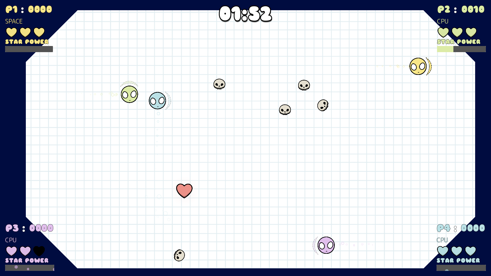
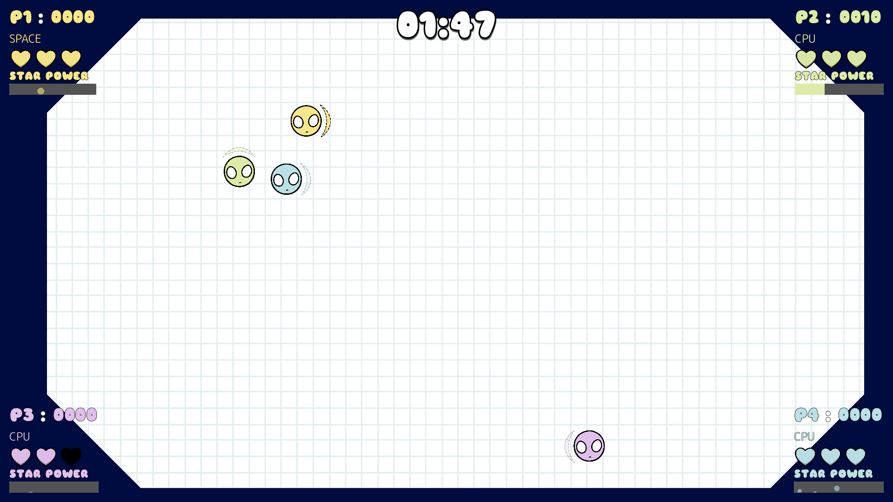

# CPU difficulty and upright respawns

Follow-up to human playtesting, 10 October 2026. Changes are uncommitted.

CPUs now follow the **same RIGHT → DOWN → LEFT → UP kick cycle as humans**. They choose when to coast or take the next kick; they cannot request an immediate opposite or skipped direction. The Player entry point enforces this too. Goal planning remains: future headings can make an intermediate setup kick worthwhile, but each intermediate kick advances just one step, pays its ordinary risk cost, and observes the cooldown. Wall bounces and collision knockback remain ordinary physics for both kinds of player.

Easier defaults:

| Setting | Previous | Now |
|---|---:|---:|
| Decision interval | 0.25 s | 0.55 s, varied ±15% |
| Minimum kick interval | 0.40 s | 0.85 s |

The initial/respawn decision also waits for the normal reaction interval. Aiming error, hesitation, power duration, movement force/caps, enemies, health and scoring rules are unchanged. These timings remain exported and easy to tune.

The sideways respawn came from the death animation setting `Sprite2D.rotation` to `PI/2`. Respawn restored scale but never rotation. Player now caches the original sprite rotation alongside its original scale and restores both. This fixes human and CPU sprites without changing their direction cycle or death/respawn timing.

## Validation

**214 runtime checks passed, zero failures:** 80 CPU/integration/respawn checks, 56 lobby regression checks, 58 gameplay checks and 20 pause checks. Logs are in this directory. The focused suite exercises all four legal cycle steps, rejects a 180-degree request without advancing the cycle, verifies slower defaults and capped real impulses, reproduces the death pose, and checks both human and CPU sprites upright after the actual respawn timer. It also retains goal, health, scoring, mixed-player, power overlap and restart checks.

Three complete 120-second headless matches ran with the same starting seeds/configurations as the earlier evidence. The harness checks **every executed CPU kick** for the next cycle step and at least the configured cooldown. `matches.log` and `matches.json` record final outcomes. Each CPU moved in all four directions and collected useful pickups; one CPU in the four-CPU round collected hearts but no stars. The collective CPU star counts were 7, 10 and 11 across the three matches.

| Configuration / seed | Old kicks per CPU | New kicks per CPU | Old CPU scores | New CPU scores |
|---|---|---|---|---|
| H + CPU / 250125 | 179 | 68 | 750 | 1110 |
| H + 3 CPUs / 250126 | 177, 174, 171 | 70, 67, 72 | 3890, 490, 5610 | 780, 20, 220 |
| 4 CPUs / 250127 | 174, 172, 165, 167 | 70, 65, 69, 58 | 20, 13780, 2390, 1240 | 780, 910, 0, 20 |

These are observations from three seeds, not a guarantee that every score decreases or a measurement of difficulty against moving humans. The mixed-match humans receive no input, and gameplay consumes random numbers as collisions occur, so changing behavior also changes later spawn/random-event sequences. Bots make substantially fewer kicks and decisions, have no direction-selection advantage, and still seek stars/hearts and enter hunt behavior when powered. Human playtesting should judge whether the slower defaults now feel comfortable.

Existing shutdown-only MP3 resource warnings remain; no new runtime script errors appeared. `git diff --check` passed.

## Actual visual check

Unstaged gameplay with one human and three slower, cyclic CPUs:



Controlled human death/respawn fixture: the normal Player death and respawn code runs, with other players frozen and spawning stopped only inside the opt-in harness. The human is repositioned to the center for inspection and returns to its original spawn point upright. This is a pose check, not a natural-match screenshot:



Both images are native 1920×1080 Godot viewport screenshots. Earlier CPU baseline images/video remain untouched.

## Reproduce

```sh
"$GODOT_BIN" --headless --path . --fixed-fps 60 --script docs/cpu_players/tools/validate.gd
"$GODOT_BIN" --headless --path . --fixed-fps 60 --script docs/cpu_players/tools/matches.gd -- --rebalance
"$GODOT_BIN" --path . --disable-vsync --fixed-fps 60 --script docs/cpu_players/tools/capture_rebalance.gd
```

Production edits are limited to `Entities/Player/cpu_controller.gd` and `Entities/Player/player.gd`. The opt-in CPU test/match tools and documentation are updated for the new constraints.
