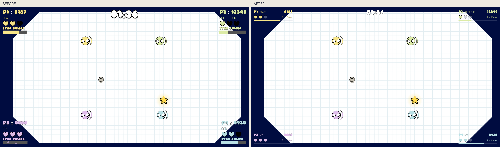
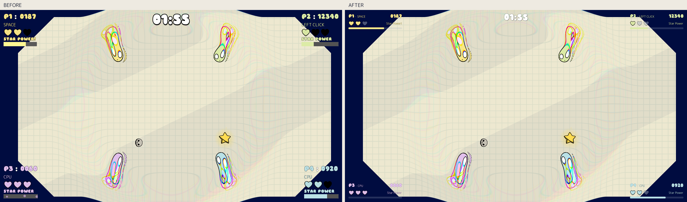
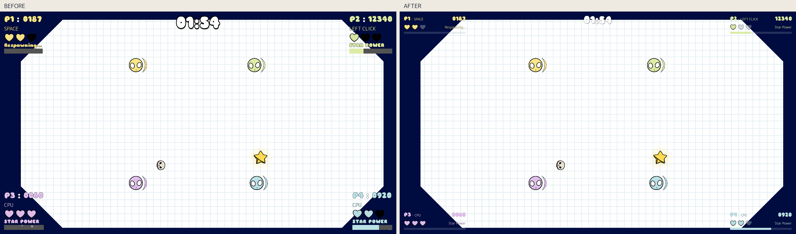

# Gameplay HUD cleanup

The four corner HUDs now use three compact rows: player/input and score, original hearts and status, then a thin rounded power bar. Player colors and both existing fonts remain. Scores still count smoothly, but no longer flash white or scale with every pickup. Empty hearts are muted instead of solid black. Persistent HUD particles are disabled, health gain pops are smaller, and the full-bar pulse is subtler. The center timer is smaller with a thinner outline.

Star Power activation reads `Star Power!`; expiry restores `Star Power`, and death shows `Respawning...` in the same reserved space. Input labels shorten with an ellipsis if necessary; the score remains complete. CPU labels and original corner identities are preserved.

## Actual gameplay comparisons

Labels are outside the original 1920×1080 screenshots. The comparison tool copies every gameplay pixel without resizing, recoloring or enhancing it, and verifies the copied pixel data. Original screenshots are preserved in `before/` and `after/`; hashes are in `screenshots.sha256`.

Normal gameplay:

Star Power:

Four HUDs including respawn status:

The baseline was captured before changing production HUD files. Both sets use the actual main scene and viewport screenshot API, fixed seed 250125, native resolution, the same camera and P1/P2 humans plus P3/P4 CPUs. The capture-only harness freezes player bodies, disables CPU decisions, stops new spawns and stages identical scores, health and progress for comparison. P1 activates the real Star Power method. The final image stages the respawn text without killing the frozen player. Rendering particles, timer and shader animation timing can vary slightly; these are real renders rather than exact deterministic pixel tests. Test setup stays in `tools/`, outside production gameplay. Baseline captures refuse to overwrite existing files.

## Modified production files

- `HUD/player_ui/player_ui.tscn`: compact layout, typography, original smaller hearts, thin bar, disabled particles.
- `HUD/player_ui/player_ui.gd`: new node paths, muted empty hearts, rounded player-color fill, calmer score/heart/bar animation.
- `HUD/HUD.tscn`: overrides for the gameplay timer only.

Documentation, capture/comparison tools and focused validation are in this directory. Earlier CPU changes and concurrent lobby styling were preserved. No commits were made.

## Validation

Godot 4.8.dev6 on macOS rendered all six screenshots graphically. Automated real-scene checks:

| Suite | Result | Coverage |
| --- | --- | --- |
| `tools/validate.gd` | 76 passed | HUD overlap, six-digit scores, long input labels, CPU labels, rapid health/bar changes, respawn/activation status, 1080p and 720p windows, inactive/non-contiguous slots |
| `../visual_cleanup/tools/validate.gd` | 58 passed | One/four-player input and physics, health, scoring, Star Power overlap/expiry, popup font and timing, game over/restart |
| `../lobby_redesign/tools/validate.gd` | 56 passed | Independent bindings, duplicate handling, mouse input, slot selection, start/results and return to lobby |
| `../visual_cleanup/tools/validate_pause.gd` | 20 passed | Escape pause, continue and return to menu |

All 210 checks passed. Logs are saved here. `git diff --check` passed. No new runtime script errors appeared. The same existing two ObjectDB instances/one resource leak messages appear at shutdown in both baseline and updated runs; this pass does not resolve them.

## Remaining playtest and scope

Small text at couch distance or in a small window still deserves a human playtest; body font size (currently 16), heart size (32), corner minimum width (300) and timer size (52) are straightforward scene values to adjust. Extremely long input names are deliberately truncated in gameplay while the lobby retains full binding information. Automated tests verify behavior and geometry, not couch readability or match feel.

No gameplay balance, scoring, physics, human controls, CPU planning, background or Star Power shader changes were made in this HUD pass. New panels, replacement artwork/fonts, enemy redesign and further arena effects changes were deliberately left out of scope.

To reproduce updated graphical captures from the repository root, use your Godot executable with `--path . --disable-vsync --fixed-fps 60 --script docs/gameplay_hud/tools/capture.gd`. Headless validation uses `--headless --path . --script docs/gameplay_hud/tools/validate.gd`. Run `python3 docs/gameplay_hud/tools/compare.py` to rebuild labeled comparisons; it uses existing project fonts for labels.
