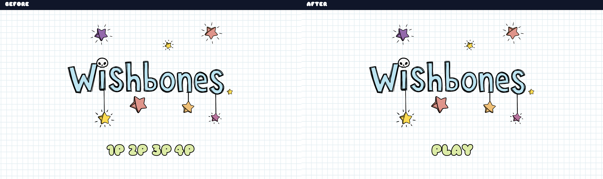
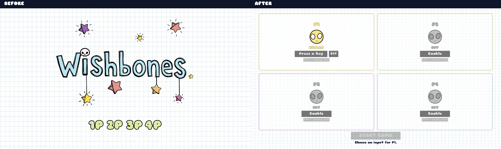
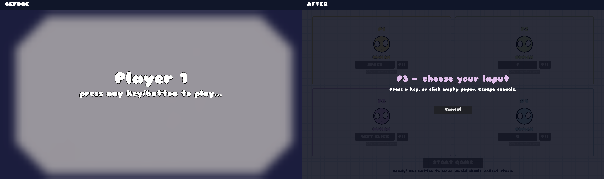
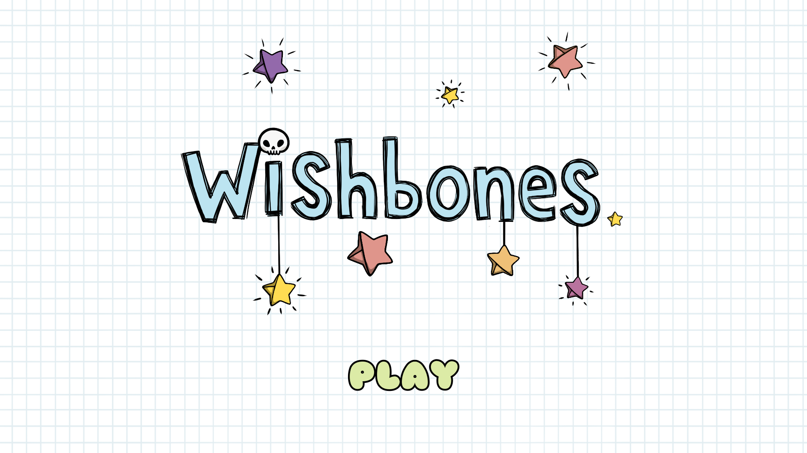
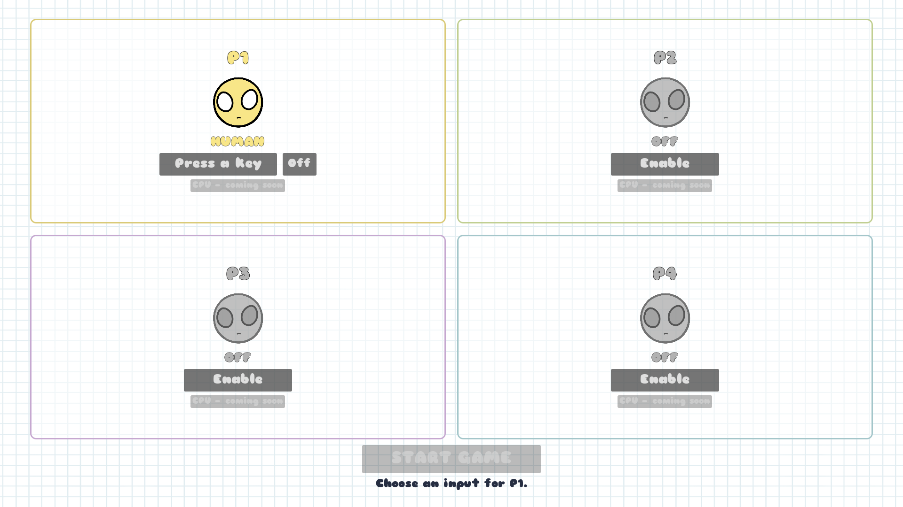
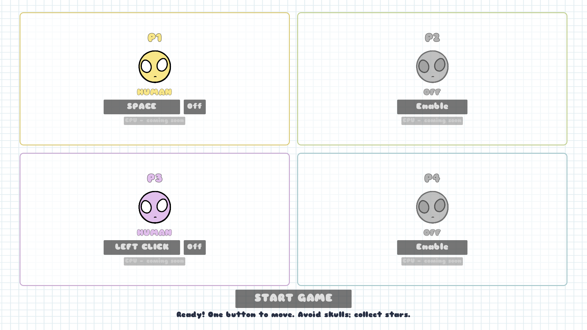
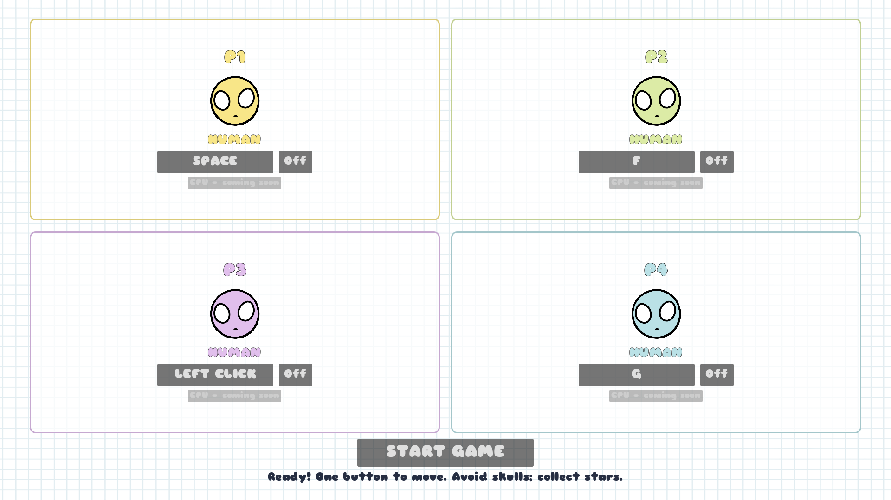
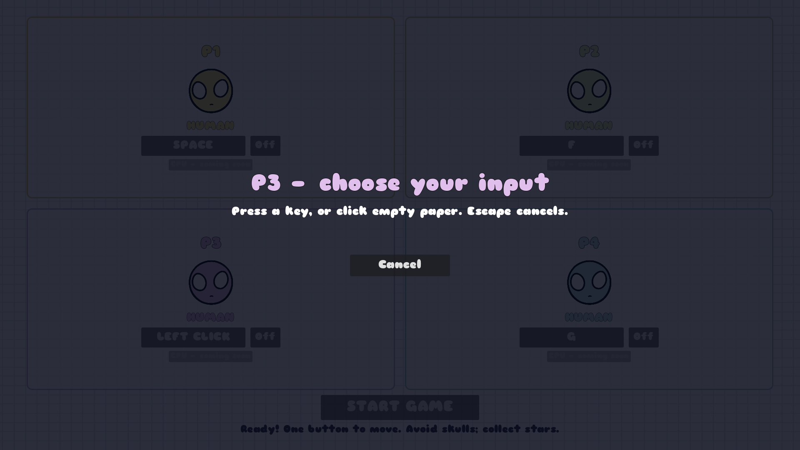
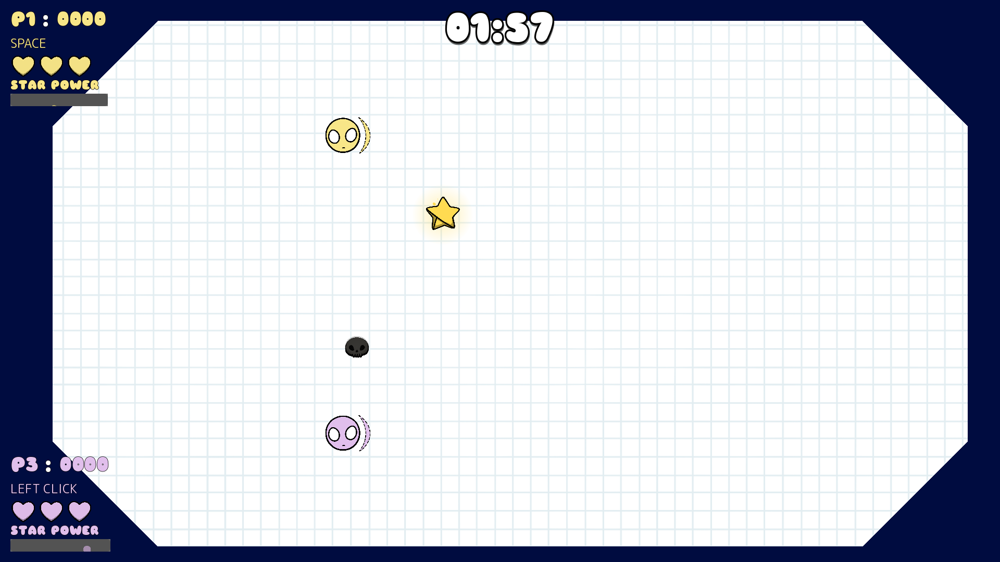
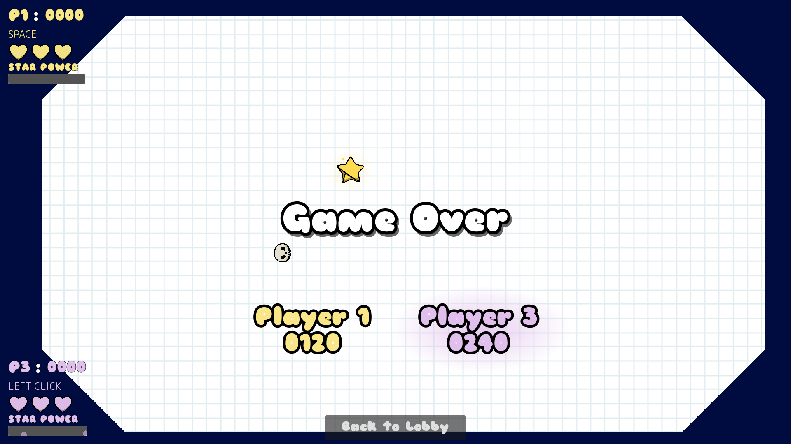

# Wishbones four-quadrant lobby

Implemented 10 October 2026. Changes are uncommitted. This report describes the original lobby pass; CPU mode has subsequently been enabled in the [CPU implementation](../cpu_players/README.md). The original title screen is retained with a single Play button; Play opens a separate four-slot lobby. CPU behavior is not implemented.

## Before and after

These are actual Godot viewport captures at 1920×1080. The two baseline PNGs were saved before any lobby edits and left untouched. Comparisons copy each screenshot at its original resolution and add labels above the gameplay pixels. No generated artwork, recoloring, enhancement or cropping of the rendered screens was used.

The title retains its artwork and replaces the player-count buttons with Play:



Play opens the logo-free selection screen with four clearly bounded quadrants:



The old sequential mapping screen and the new independent capture overlay serve the same binding role. The new image deliberately captures P3 to demonstrate independent slots:



## New screen gallery

Title screen with Play.



Default: P1 HUMAN without a binding; P2–P4 OFF. Start explains the missing input and remains disabled.



Two non-contiguous humans: P1 SPACE and P3 LEFT CLICK.



Four humans with independent bindings.



One player capturing an input; Escape or Cancel leaves the previous successful binding intact.



Gameplay with only P1 and P3, preserving their original colors, corners, inputs and spawn positions.



Additional results capture: original Player 1 and Player 3 identities, plus a visible Back to Lobby button. This inspection screenshot uses staged scores of 120 and 240; it is not a claim about a naturally played match.



## Implementation

- Four instances of a reusable `player_slot.tscn` in a 2×2 GridContainer. Existing body/face textures, graph paper, player colors and Sniglet theme are reused. Each slot has a rounded colored boundary; the logo is kept on the title screen. Inactive previews are dimmed; enabling or successfully binding gives a small preview bounce.
- `player_slot_config.gd` stores slot ID, OFF/HUMAN/CPU mode and an InputEvent. All CPU buttons are disabled and validation explicitly rejects CPU configurations.
- `lobby.gd` owns four independent configurations. P1 begins HUMAN with no binding; every old `player0`–`player3` action event is cleared on initial launch. Disabling clears the slot's binding. A successful remap replaces its old action event; duplicate bindings are rejected without losing the previous valid binding.
- `mapping_screen.gd` is now a single modal capture overlay. It supports keys and mouse buttons, shows the current player, ignores the opening click, prevents binding UI clicks, reserves Escape for cancellation and Tab for navigation, and blocks clicks through to underlying lobby controls. Only one slot captures at a time.
- `start_sequence.gd` sends copied slot configurations through the existing HUD start signal. `new_game(configuration)` validates them and instantiates only HUMAN IDs. Existing PlayerData provides the original spawn point, input action, color and HUD corner; the Player class and movement code are unchanged by this task.
- Inactive HUDs are hidden before each match. Results now carry `{id, score}` entries instead of treating the result-array index as the player ID. The original results artwork and score display are retained.
- Results and the Escape pause menu return to the same editable lobby, retaining configured inputs and modes. Shared Star Power effects, timers and players are cleared on return. The results return button is positioned below the scores and ordered above the results container so it remains visible and clickable.

No new singleton, framework, downloaded graphics, fonts or gameplay mechanics were added. Gameplay background/Star Power visuals, scoring, movement and physics balance were not changed in this task. Earlier visual cleanup, pause work and pre-existing unrelated edits remain intact.

## Files changed

New:

- `HUD/GameStart/lobby.gd` and `.tscn`
- `HUD/GameStart/player_slot_config.gd`
- `HUD/GameStart/player_slot/player_slot.gd`
- `HUD/GameStart/player_slot/player_slot.tscn`

Updated:

- `HUD/GameStart/title_screen.gd` and `.tscn`
- `HUD/GameStart/mapping_screen.gd` and `.tscn`
- `HUD/GameStart/start_sequence.gd` and `.tscn`
- `HUD/hud.gd` and `HUD/HUD.tscn`
- `main.gd`
- Earlier isolated `docs/visual_cleanup/tools/` harnesses, adapted to selected-slot startup and returning to the editable lobby.
- This documentation directory, screenshots, comparisons, hashes, logs and opt-in harnesses.

## Validation

**134 runtime checks passed, zero failed:**

| Suite | Checks | Evidence |
|---|---:|---|
| Lobby interaction and integration, including Title to Play | 56 | `validation.log` |
| Existing gameplay regression | 58 | `gameplay_regression.log` |
| Escape pause regression | 20 | `pause_regression.log` |

The lobby suite sends actual Godot InputEventKey/InputEventMouseButton events through Input.parse_input_event and clicks the displayed GUI button rectangles. It tests default states, missing-input Start rejection, enabling/off, keyboard and mouse binding, duplicate key and duplicate mouse rejection, remapping, Escape/Cancel, UI click exclusion, one/four/non-contiguous starts, HUD visibility/labels/colors, original spawn points, both players' movement, score/health, P3 Star Power, original result IDs/scores, results return, pause return, starting another round and rejecting CPU/empty-key configurations. Button positions are read after Container layout updates.

The existing gameplay suite checks health/scoring, real physics movement, all four HUDs, popup font/lifetime, activation thresholds, overlapping Star Power timers, shared background/music/enemy freeze, reset and game over. Pause tests verify frozen movement and timers, music pause/resume, Continue, Escape and return during a music crossfade.

Normal graphical startup without a harness was also checked (`startup.log`). The restored title and all required lobby screenshots rendered successfully on Godot 4.8.dev6, OpenGL Compatibility, Apple M4 Pro. No new gameplay script errors or warnings appeared in the final runs. The baseline's existing exit-only diagnostics remain in some runs: two ObjectDB instances leaked and one resource still in use. This is not a completely warning-free engine run.

`git diff --check` passed. Comparison copies were verified pixel-for-pixel against the original PNGs. `screenshots.json` records source dimensions and SHA-256 hashes.

## Reproduction and manual review

From the repository root, with `GODOT_BIN` set to the installed Godot executable:

```sh
"$GODOT_BIN" --headless --path . --script docs/lobby_redesign/tools/validate.gd
"$GODOT_BIN" --headless --path . --script docs/visual_cleanup/tools/validate.gd
"$GODOT_BIN" --headless --path . --script docs/visual_cleanup/tools/validate_pause.gd
# Recaptures only after images; baseline files are never written by this harness.
"$GODOT_BIN" --path . --fixed-fps 60 --script docs/lobby_redesign/tools/capture.gd
```

The opt-in capture harness uses seed 250125 and the real main scene, configuring slots without replacing production logic. It captures default, two-player, four-player, capture-overlay, P1/P3 gameplay, and an additional staged results screen. Gameplay capture stops spawning after the first original enemy/pickup spawn and pauses the tree when saving the frame. Screenshot conditions demonstrate identities and layout, not human play feel.

Human physical keyboard/mouse playtesting, unusual keyboard layouts, resize/accessibility preferences and audio mix still need manual review. The existing project viewport stretch scales the Control/Container layout with the game window. CPU controls are intentionally unavailable.

## CPU integration next phase

`PlayerMode.CPU` and original slot IDs already exist in the configuration. A later phase can enable that option, allow CPU configurations through validation without human bindings, and attach a CPU controller to the corresponding original Player. The controller can disable that player's human `_input` processing and invoke the existing direction/kick methods. Keep PlayerData, HUD corners, scoring and results IDs unchanged. No controller, CPU movement or AI decision logic has been added here.
