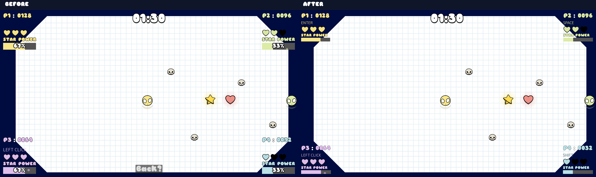
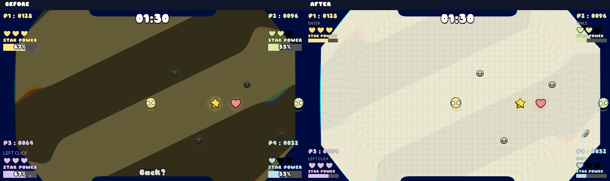
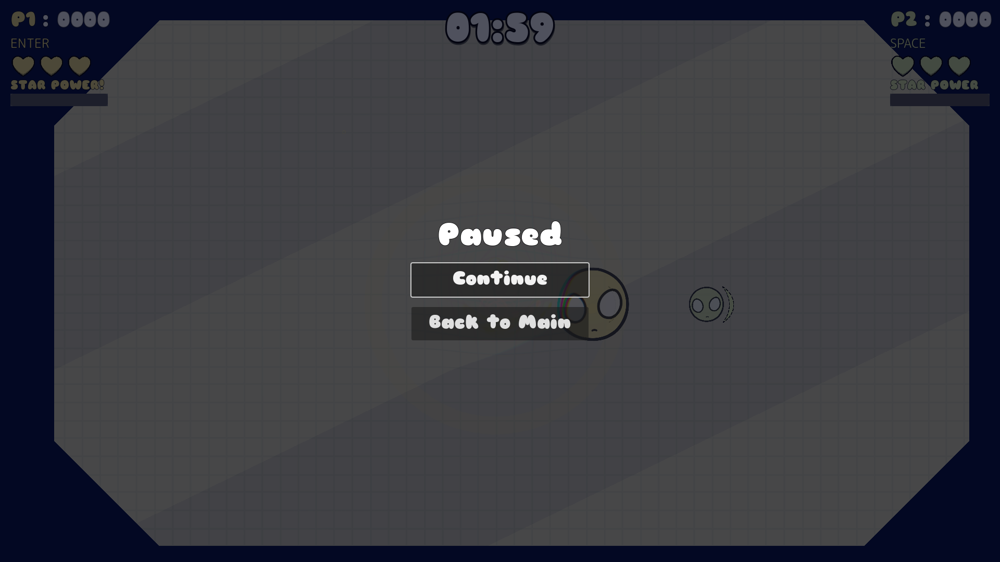

# Wishbones visual cleanup

Captured and validated 10 October 2026 using the installed Godot 4.8.dev6 runtime, macOS OpenGL Compatibility renderer on Apple M4 Pro. Changes remain uncommitted.

## Before and after

Screenshots come directly from the actual main scene viewport at 1920×1080. Baselines were saved before any production edits and left untouched. Each comparison copies both original screenshots at full resolution and adds labels outside the gameplay pixels. No recoloring, enhancement, cropping of gameplay, or generated art is involved. `screenshots.json` records the original PNG hashes and dimensions.

### Normal gameplay



### Star Power



### Four corner HUDs


## Implemented changes

- Retained the original moving diagonal stripe shader, speed, angle and player tint. Lightened its stripe colors and exposed a 0.48 activation opacity followed by a calmer 0.32 sustained opacity. Fade-out begins at the current opacity.
- Frozen skulls retain 85% opacity instead of 30%, preserving the hand-drawn fill and black outline. The next-direction indicator uses a clearer 75% opacity without enlarging it.
- Kept all four corner HUDs, existing fonts, hand-drawn hearts and color scheme. Tightened vertical spacing, reduced score/status outlines and status size, and removed numerical bar percentages. Bars are 24 pixels tall; active state reads “STAR POWER!”. Keyboard hints now correctly display physical-key bindings.
- Removed Back from gameplay. Escape opens a paused overlay with Continue and Back to Main, using the existing theme and font. Escape or Continue resumes; Back to Main clears shared power effects and returns to the title screen. Escape is reserved during player input mapping. Movement, round/power timers, HUD animations and music pause together.
- Replaced the power bar's repeated shaking, flashing and scaling with one restrained brightness pulse. Removed the independent five-second UI effect timer; the actual player expiry resets its state. Score, health and respawn animations cancel previous animations affecting the same properties.
- Ordinary popups use the intended existing Sniglet font, 24-pixel text instead of 28, and half the previous duration (0.75 seconds instead of 1.5). Significant combo effects remain unchanged.
- Added a small list of powered players in `main.gd`. The latest active player colors the background. Ending one player's power preserves shared music/background/enemy freeze while another remains powered. Powered players retain their original boosted speed; unpowered players retain the existing slowdown. The last expiry restores normal shared state. Round reset and game over clear the list.
- Removed the unused empty music tween initializer, which produced a startup error in the baseline.

No artwork, fonts, shader implementation, collision shapes, input mappings, score multipliers, spawn rates, durations, movement forces or physics constants were changed. The overlap fix corrects the previously premature slowdown/shared-state reset.

## Files modified by this pass

- `Background/background.gd`
- `Entities/Enemy/enemy.gd`
- `Entities/Player/player.gd` (indicator modulation only)
- `HUD/HUD.tscn`
- `HUD/hud.gd`
- `HUD/GameStart/mapping_screen.gd`
- `HUD/player_ui/player_ui.gd`
- `HUD/player_ui/player_ui.tscn`
- `Music/music_manager.gd` (empty initializer removal and waiting for an in-progress crossfade before returning to normal music)
- `PopupFx/popup_fx.gd`
- `main.gd`
- This documentation directory: seven viewport PNGs, three comparisons, hashes, isolated harnesses and validation logs.

Existing edits to `.gitignore`, the root `README.md`, `main.tscn`, `Entities/Player/player.tscn`, and untracked `publish.sh` were preserved. They are not part of this cleanup.

## Capture conditions and reproduction

`tools/capture.gd` is an opt-in external SceneTree harness, never referenced by the game's main scene. It seeds randomness with 250125, loads the existing main scene and starts two actual players. It shows all four HUDs with fixed scores (128/96/64/32), health (3/2/3/1), progress (2/1/2/1), and a 01:30 timer. It places four original skull scenes, original pickup scenes and the two players at fixed positions; player rigid bodies are frozen only inside this harness. After spawn animations settle it pauses and captures normal gameplay, then triggers the actual first player's Star Power and captures that state.

Normal and HUD screenshots intentionally capture the same full-arena frame: all four panels already appear in the normal scenario. Players 3 and 4 are HUD reference states, not active gameplay participants. Shader time, particles and the activation shockwave can vary slightly between runs. This provides matched composition and gameplay state, not pixel-identical animation phases. Frozen capture bodies also do not demonstrate transformation movement/scale; the live timer/physics tests provide separate behavioral evidence.

The original run waited for `RenderingServer.frame_post_draw`. An occluded-window wait stalled one after attempt, so the saved harness explicitly calls `RenderingServer.force_draw()` before reading the same viewport texture. Final after captures used `--fixed-fps 60`. Neither method alters the screenshot pixels after capture.

With `GODOT_BIN` set to the installed Godot executable, run from the repository root:

```sh
# Use a fresh destination so the mandatory baseline stays intact.
mkdir -p /tmp/wishbones-review
"$GODOT_BIN" --path . --fixed-fps 60 --script docs/visual_cleanup/tools/capture.gd -- /tmp/wishbones-review
"$GODOT_BIN" --headless --path . --script docs/visual_cleanup/tools/validate.gd
```

## Validation results

- Graphical viewport capture: all six PNGs saved successfully at native resolution; original gameplay pixels verified unchanged in the three comparison montages.
- Normal graphical main-scene startup without the harness: checked separately; see `startup.log`.
- Runtime validation: **58 checks passed, zero failed**; see `validation.log`. Uses the actual game classes, simulated Godot input events and physics frames, rather than replacing player behavior. Checks one-player movement, independent controls for all four players, four HUDs, damage/healing, ordinary scoring, pickup-threshold activation, boosted movement values, staggered five-second player timers, shared background/music/spawner state, actual enemy freeze/resume, last-expiry restoration, overlay fade-out, rapid score/health updates, popup font/size/lifetime, round reset and game over.
- Diff review and `git diff --check`: passed. Production movement/scoring scripts remain unchanged except the requested indicator appearance and minimal shared-power handling.
- No missing assets or new gameplay script errors observed. The baseline's empty music tween error is resolved. Baseline and after runs both report the existing shutdown warnings: two ObjectDB instances leaked and one resource still in use. These exit-only diagnostics remain unresolved; this is not a completely warning-free engine run.

## Manual review still needed

- Human local-multiplayer play feel, physical keyboard/mouse remapping, held-key behavior and audio mixing have not been certified by the scripted tests.
- Review the calmer sustained background, pale player colors, active label and pause menu readability on your intended display. Activation and shader opacity are exposed for tuning. Inactive-player panel behavior remains as before.
- Review moving Star Power transformations and significant combo sequences in an ordinary round; staged screenshots freeze player bodies and do not assess those animations.
- Investigate the pre-existing shutdown resource warnings separately if they matter for release readiness.

## Deliberately out of scope

New graphics/fonts, redesigned panels, new glow/outline shaders, enlarged enemies, a different background, changed one-button controls, revised physics/balance/scoring, spawn/freeze architecture rewrites, music crossfade redesign, and publishing or committing changes.

## Escape pause menu follow-up

The follow-up removes the persistent gameplay Back control. The three after screenshots and comparison montages have been refreshed; original before screenshots remain untouched. The capture harness no longer displays Back.



`tools/validate_pause.gd` exercises Escape, key auto-repeat, title-screen behavior, reserved Escape mapping, Continue focus and button, paused input/physics, paused round and power-up timers, music pause/resume, title return during Star Power, starting a fresh round, and returning during an unfinished music crossfade. See `pause_validation.log` for the results. The existing 58 gameplay checks were rerun and passed. Pre-existing shutdown resource warnings remain.
